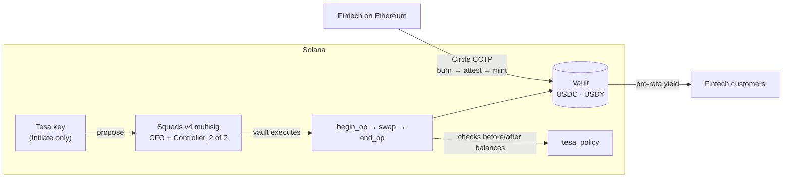

# Tesa — on-chain treasury policy for USDC → USDY on Solana

Tesa is B2B treasury software. Fintechs and companies keep their USDC in their own
[Squads](https://squads.so) multisig and put it to work in [Ondo USDY](https://ondo.finance/usdy)
(tokenized US Treasuries) on Solana. A fintech built on Ethereum moves its USDC over with Circle
CCTP. Treasury rules are enforced on-chain by the `tesa_policy` program, and Tesa can only
**propose** operations: the client's signers approve and execute them.

**Live demo:** [demo.t3sa.com](https://demo.t3sa.com) — runs on Solana testnet, reads and signs
directly from the browser. · **Site:** [t3sa.com](https://t3sa.com)

- **Non-custodial.** Money never leaves an account the client controls.
- **Tesa proposes, the client signs.** Tesa's key has the Squads `Initiate` permission only.
- **Rules on-chain.** Allocation cap, liquidity floor, per-operation cap, slippage against the
  USDY NAV and price freshness are checked inside every transaction.
- **Traceable.** Every execution emits an `OpExecuted` event and updates an on-chain cost basis,
  so yield is auditable.

## How it works



One operation is a single Solana transaction executed by the Squads vault:

| Step | What it does |
|---|---|
| `begin_op` | Checks pause, NAV freshness, per-operation cap and balance; snapshots vault balances in an `OpReceipt` |
| swap | USDC ⇄ USDY. Jupiter → Orca in production; `mock_swap` in the demo |
| `end_op` | Checks the outcome, updates the position (cost basis, realized P&L), emits `OpExecuted`, closes the receipt |

If any check fails, the whole transaction reverts, swap included. The policy never calls the
swap via CPI: it measures vault balances before and after. That keeps the CPI depth within
Solana's limits under Squads (Squads → Jupiter → Orca → Token) and works with any route, because
instruction introspection does not work inside a Squads vault transaction.

### Checks in `end_op`

| Rule | Error |
|---|---|
| Exactly `amount_in` left the vault (nothing else moved) | `AmountInMismatch` / `UnexpectedBalanceChange` |
| Received ≥ `min_out` | `BelowMinOut` |
| Effective price within `max_slippage_bps` of the USDY NAV (adverse side only) | `SlippageExceeded` |
| Allocations only: USDY value / total treasury ≤ `max_yield_bps` | `YieldCapExceeded` |
| Allocations only: USDC ≥ `min_liquid_usdc` | `BelowMinLiquidity` |

Redemptions are never blocked by the allocation cap or the liquidity floor, since they always move
the vault back toward the policy.

## What the demo shows

The panel at [demo.t3sa.com](https://demo.t3sa.com) runs against real Squads v4 and `tesa_policy`
programs on Solana testnet:

1. USDC arrives in the vault from Ethereum (CCTP leg simulated, see below).
2. The Tesa key proposes an allocation. When it tries to approve, the transaction fails on-chain
   with `Unauthorized`.
3. CFO and Controller approve; the vault executes `begin_op → swap → end_op` in about a second.
4. An allocation above the per-operation cap is approved by both humans and still **fails on-chain**
   with `ExceedsMaxOp`, with a Solscan link.
5. The market moves after approval: the swap executes and `end_op` reverts it.
6. A higher NAV is published: yield grows for the vault and for each of the fintech's customers.
7. A redemption settles in about a second.

**Simulated in the demo:** USDC and USDY are test tokens, the swap is `mock_swap` (configurable
price and slippage), the CCTP deposit only mints test USDC (Circle's CCTP connects Ethereum Sepolia
to Solana devnet, not testnet), and the per-customer split is computed in the panel from on-chain
data. Demo keys for every role are bundled in the page, so anyone with the link can operate the
demo vault. They hold testnet SOL only.

## Repository

```
programs/tesa_policy/   policy program (Anchor): initialize/update/pause, begin_op/end_op/cancel_op, price feed
programs/mock_swap/     simulated USDY mint + swap with configurable price and slippage (test networks only)
tests/tesa_policy.ts    every policy check, success and failure, atomicity after each failure
tests/squads.ts         the same flow through a Squads v4 multisig (permissions, approvals, execution)
tests/fixtures/         Squads v4 program and ProgramConfig dumped from mainnet, loaded into the local validator
app/                    demo panel (Vite + React), reads and signs on testnet with no backend
docs/dev-notes-pt.md    detailed development notes and design decisions (Portuguese)
```

### Deployed programs

Same program IDs on Solana devnet and testnet:

| Program | ID |
|---|---|
| `tesa_policy` | `9oTWN6zV7bZfdqtSNRXJ92tSmuGJLqaetsGTQkC2L8wB` |
| `mock_swap` | `2khHAreRkYwwB2RTEJMzcsfsYdV9N1Pepp3Win8sxKUB` |
| Squads v4 (official) | `SQDS4ep65T869zMMBKyuUq6aD6EgTu8psMjkvj52pCf` |

## Run it

Requirements: Rust ≥ 1.89, Solana CLI (Agave) 4.1, Anchor 1.2.1 (via `avm`), Node LTS + yarn,
and [Surfpool](https://surfpool.run) (the default local validator of `anchor test` in Anchor 1.x).
On Windows, use WSL.

```bash
yarn install
anchor keys sync              # use your own program IDs
anchor build
anchor test                   # 27 tests on Surfpool; or: anchor test --validator legacy
cargo test -p tesa_policy     # unit tests for the policy math
```

### Demo panel

```bash
cd app
yarn install
# creates a fresh demo vault on testnet (multisig, test tokens, policy) and writes src/demo-config.json
# needs ~1 testnet SOL in ~/.config/solana/id.json
RPC_URL=https://api.testnet.solana.com CLUSTER=testnet npx tsx scripts/setup-demo.ts
yarn dev
```

See [`app/src/demo-config.example.json`](app/src/demo-config.example.json) for the shape of the
generated file.

## Tech stack

| Layer | Today | Next |
|---|---|---|
| Custody | Squads v4 multisig | same |
| Rules | `tesa_policy` (Rust, Anchor 1.2.1) | same, plus on-chain sub-accounts per end customer |
| Swap | `mock_swap` | Jupiter Swap API v2 → Orca USDY/USDC, Squads transaction buffer + lookup tables |
| Price | Tesa-maintained `PriceFeed` (USDY NAV) | Pyth USDY feed when an active one exists |
| Cross-chain | simulated deposit | Circle CCTP V2 |
| Panel | React + Vite, static on Netlify | Next.js with real wallets |
| Backend | none (browser talks to Solana) | Fastify API, Helius webhooks, Postgres cache |

## Risks and limitations

- **Unaudited.** Use minimal amounts on mainnet.
- **Issuer risk.** USDY can be frozen by Ondo (freeze authority confirmed on-chain), and Ondo's terms
  exclude US persons, so onboarding must collect that.
- **Reference price.** Without an active Pyth feed, a Tesa key publishes the NAV. Mitigations:
  `max_price_age_secs`, a monotonic `publish_ts`, and the policy points to one feed that only the
  vault can change.
- **Liquidity.** The USDY/USDC pool on Orca is shallow (~US$2.9M). The NAV slippage check protects the
  client but can make large operations fail.
- **Upgrade authority** is a single key for the MVP; production needs a multisig with timelock or an
  immutable program.

## License

[MIT](LICENSE)
